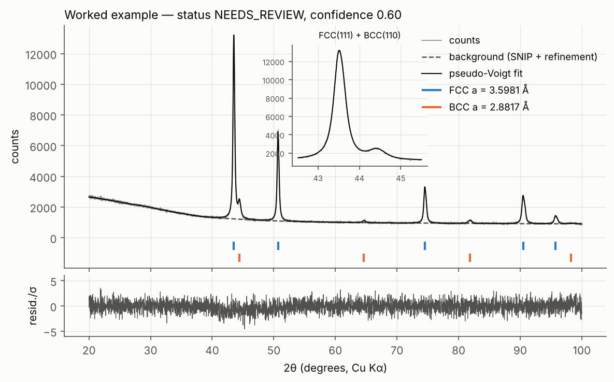
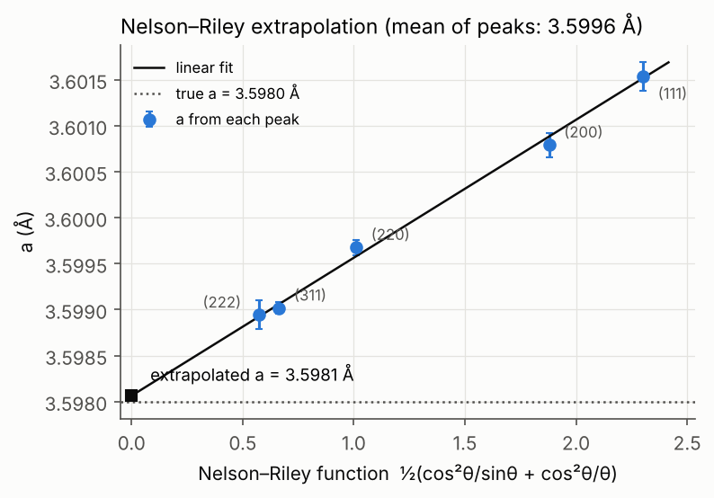
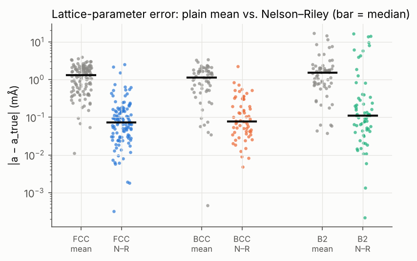
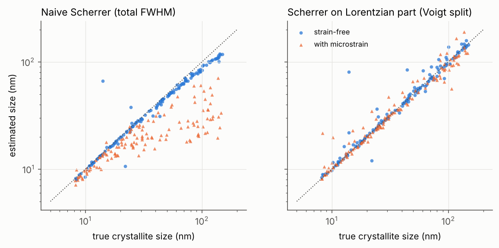

# xrd-phase-id — automated XRD phase identification for high-entropy alloys

A Python pipeline that takes a Cu Kα powder-diffraction pattern of a high-entropy alloy (HEA) and works out:

* **which phases** are present (FCC, BCC, B2, sigma),
* each phase's **lattice parameter** (Nelson–Riley extrapolation),
* its **crystallite size** and **microstrain** (Scherrer, on the Lorentzian part of a Voigt split),
* a **confidence score** for every result and a list of **review flags**. Ambiguous cases go to a human instead of being forced into a match.

It's tested on 200 synthetic patterns with known answers (plus a 200-pattern held-out set). This README explains the physics behind each step, then reports where the pipeline works and where it fails.

The code is heavily commented on purpose. Each module's docstring is a short lesson on that step.

```
xrd_phase_id/
  constants.py   Cu Kα1/Kα2, Scherrer K, instrument (Caglioti) parameters
  phases.py      crystal structures (pymatgen) + rescalable reference patterns
  simulate.py    realistic synthetic patterns: doublet, broadening, noise, background, texture, mixtures
  background.py  step 1: SNIP background + second-pass refinement
  peaks.py       steps 2–3: peak finding against Poisson noise, pseudo-Voigt doublet fitting
  matching.py    step 4: lattice-parameter-scanning search–match, hypothesis scoring
  lattice.py     step 5: Nelson–Riley (cubic) / LSQ a,c + displacement (tetragonal)
  size.py        step 6: Scherrer size, Voigt split, microstrain
  pipeline.py    orchestration, confidence score, review flags
scripts/
  run_benchmark.py   200 synthetic samples -> results/benchmark.json
  make_report.py     figures + results/BENCHMARK.md
  analyze_xy.py      analyse your own two-column (2θ, counts) file
tests/               pytest checks of each stage against ground truth
```

## Quick start

```bash
pip install -r requirements.txt
```

```bash
python -m pytest -q
```

```bash
python scripts/run_benchmark.py && python scripts/run_benchmark.py --seed 7 && python scripts/make_report.py
```

```bash
python scripts/analyze_xy.py my_scan.xy
```

```python
from xrd_phase_id import analyze
res = analyze(two_theta, counts)
print(res.summary())          # human-readable
res.to_json()                 # everything, incl. per-peak fits and N–R data
```

On Debian/Ubuntu's system Python, `pip install pymatgen` can fail while building `bibtexparser`. Using a virtualenv (`python -m venv .venv`) avoids it. The benchmark sets `OMP_NUM_THREADS=1` per worker; without that, the parallel workers fight over BLAS threads and run 10–30× slower.

---

## 1. The physics, step by step

### 1.0 What a diffraction pattern is

X-rays scatter off the electrons of every atom. In a crystal the scattered waves only add up constructively in particular directions, given by **Bragg's law**:

  **λ = 2 d<sub>hkl</sub> sin θ**

Here d<sub>hkl</sub> is the spacing of the (hkl) lattice planes and 2θ is the angle between the incident and diffracted beams. For a cubic crystal with lattice parameter *a*:

  d<sub>hkl</sub> = a / √(h² + k² + l²)

So peak **positions** tell you the lattice geometry (which crystal system, and its size *a*). Peak **intensities** tell you what's inside the cell, through the structure factor F<sub>hkl</sub> = Σ f<sub>j</sub> exp[2πi(hx<sub>j</sub> + ky<sub>j</sub> + lz<sub>j</sub>)]. Peak **shapes** tell you about crystallite size and defects.

### 1.1 The phases (`phases.py`)

| phase | space group | why the pattern looks the way it does |
|---|---|---|
| **FCC** (CoCrFeNi, a ≈ 3.57–3.64 Å) | Fm-3m | F = 0 unless h,k,l are all odd or all even → (111), (200), (220), (311), (222) |
| **BCC** (AlCoCrFeNi a ≈ 2.87–2.92 Å; refractory NbMoTaW-type a ≈ 3.2–3.4 Å) | Im-3m | F = 0 unless h+k+l is even → (110), (200), (211), (220) |
| **B2** (ordered BCC, NiAl-type) | Pm-3m | Al prefers the cube corner and Ni/Co/Fe the body centre, so the two sites no longer cancel. **Superlattice** peaks (100), (111), (210) appear with intensity ∝ (f<sub>Al</sub> − f<sub>Ni</sub>)² · S², where S is the long-range order parameter |
| **Sigma** (Cr-rich, FeCr-type, 30 atoms/cell) | P4₂/mnm | Big tetragonal cell → many weak reflections crowded into 2θ ≈ 39–52°, exactly where the strongest FCC/BCC lines are |

Disordered sites are given fractional occupancies (e.g. Co<sub>0.25</sub>Cr<sub>0.25</sub>Fe<sub>0.25</sub>Ni<sub>0.25</sub>). pymatgen then uses the occupancy-weighted average scattering factor, which is what X-rays "see" in a random solid solution.

**Key consequence for HEAs:** the lattice parameter is *not* known in advance, because it depends on composition. So classic search–match against fixed database d-spacings doesn't work. The matching step (§1.5) scans *a* for every phase.

### 1.2 What a real measurement adds (`simulate.py`)

pymatgen's `XRDCalculator` gives ideal sticks (|F|² × multiplicity × Lorentz–polarisation). A real lab pattern adds:

1. **Kα1/Kα2 doublet.** The Cu tube emits 1.5406 Å and 1.5444 Å at a 2:1 ratio. Every peak has a twin on its high-angle side, about 0.1° away at 2θ = 40° and 0.26° away at 90°.
2. **Broadening**, simulated as a true Voigt (Gaussian ⊗ Lorentzian):
   * instrument: Caglioti, FWHM² = U tan²θ + V tanθ + W (Gaussian)
   * crystallite size D: β = Kλ / (D cos θ) (Lorentzian)
   * microstrain ε: β = 4 ε tan θ (Gaussian)
3. **Specimen displacement.** A sample surface s mm below the goniometer axis shifts peaks by Δ2θ = −2s cos θ / R. This is the dominant *systematic* error in lab lattice parameters.
4. **Background**: a flat level (for HEAs this is mostly Fe/Co/Cr fluorescence under Cu radiation), air scatter rising at low angle, and an amorphous hump.
5. **Poisson counting noise.** A point with N counts has σ = √N.
6. **Texture**: random log-normal perturbation of each reflection's intensity (σ up to 0.25).
7. **Mixtures**: each phase is weighted by volume fraction × |F|²/V<sub>cell</sub>² (the basis of quantitative phase analysis).

Benchmark parameters were drawn at random: peak counts 1.5k–60k, background 2–15% of max, displacement ±0.15 mm, D = 8–150 nm (log-uniform), ε = 0 or 0.05–0.3%, B2 order S = 0.4–1.0, minor-phase fraction 3–50%.

### 1.3 Step 1 — Background (`background.py`)

**SNIP** (statistics-sensitive non-linear iterative peak clipping): at each point, replace y[i] with min(y[i], ½(y[i−p] + y[i+p])) for windows p shrinking from 2.5° to one step. This is done on a log-log-sqrt transformed scale so strong and weak features are treated similarly. Narrow peaks get clipped off; slow background survives.

**A lesson from the benchmark:** SNIP is biased low wherever the true background curves *downward*, e.g. the top of an amorphous hump. The clipping error there is about ½·B″·p², and we measured up to **14%** low. A low background turns noise into "peaks". The fix is to estimate background and peaks *jointly*: fit the peaks, subtract them, smooth what's left (running median, then mean), and refit. Because SNIP can only err downward, the final background is `max(SNIP, refined)`. Worst-case background error dropped from 14% to about 2%.

### 1.4 Steps 2–3 — Peak finding and pseudo-Voigt fitting (`peaks.py`)

**Finding.** Smooth the net signal with a Savitzky–Golay filter and work out the noise of the *smoothed* data exactly (σ<sub>s</sub> = √(Σc<sub>i</sub>²)·√N<sub>bg</sub>). Then accept maxima more than **4σ** above the background. That 4σ threshold is the **limit of detection (LOD)**, and it's a physical limit: no algorithm can see a peak that is smaller than the noise. Resolved Kα2 twins are recognised and dropped.

**Fitting.** Each reflection is a **pseudo-Voigt doublet**:

  pV(x) = A[η L(x; x₀, H) + (1 − η) G(x; x₀, H)]  + ½·(same at the Kα2 position)

The Kα2 position comes from Bragg's law (sin θ₂ = (λ₂/λ₁) sin θ₁), so each peak has only four free parameters (x₀, A, H, η), and x₀ is directly the **Kα1** position used for d-spacings. Overlapping peaks are fitted together with a local linear background, by **weighted** least squares (weights 1/√N). That makes χ²<sub>red</sub> ≈ 1 mean "fits to within counting noise". If the residual still shows a > 4σ bump, a peak is added there, but only if it lowers the BIC (χ² + k ln n). That's how a weak BCC(110) hiding on the shoulder of FCC(111) gets found (inset of the figure below). An analytic Jacobian makes the many-peak sigma fits about 10× faster. FWHM is capped at 2.5°: anything broader is background, and letting "peaks" get that wide made them absorb background errors.



*FCC + 12% BCC, 12k counts. Residuals are flat noise (|r| < 4σ). The pipeline found both phases with the right lattice parameters, but still sends this sample to review. BCC is identified from only one isolated peak, and with BCC this weak, a B2 component with f·S² < 0.56 couldn't be excluded (see §1.7). This is the intended behaviour.*

### 1.5 Step 4 — Phase matching (`matching.py`)

For each library phase:

1. **Scan** the lattice parameter over a window (e.g. BCC 2.84–3.42 Å, step 0.03%). For tetragonal sigma, also scan c/a ±1.2%: a fixed c/a missed the (00l)-type lines and caused failures in early runs. Score each value by (fraction of the predicted pattern found) × √(fraction of observed intensity explained), using soft Gaussian matching. Rescaling the stored pattern is exact for d (d ∝ a). Intensities are corrected only for the angle-dependent Lorentz–polarisation factor; the structure-factor part barely changes.
2. **Refine** the top 3 local maxima by linearised least squares on matched peaks: ∂(2θ)/∂ln a = −2 tan θ, plus a displacement term δ·cos θ (and ∂/∂ln c for sigma).
3. **Hypotheses:** every single phase and every pair of different phases (up to 66 candidate combinations). Each is scored by

   FOM = (fraction of observed peak area explained) − 0.5 × (fraction of *expected-visible* predicted intensity that's missing) − 0.02 × (n<sub>phases</sub> − 1)

   "Expected-visible" means predicted to be above 2× the LOD measured from *this* pattern's noise. A 5% minor phase's weak lines aren't expected, so their absence isn't penalised.
4. **A phase must earn its place:** at least 2 matched peaks, at least one strong (SNR ≥ 5) peak that no other phase in the hypothesis explains, and for **B2, at least one superlattice peak**. Without one, B2 is indistinguishable from BCC, so the simpler BCC wins.

### 1.6 Step 5 — Lattice parameter by Nelson–Riley (`lattice.py`)

Each clean peak gives a<sub>hkl</sub> = d<sub>hkl</sub>·√(h²+k²+l²). Specimen displacement, absorption and similar errors make a<sub>hkl</sub> drift with angle, and **all of them vanish as θ → 90°**. Nelson and Riley showed the drift is close to linear in

  f(θ) = ½ (cos²θ / sin θ + cos²θ / θ)

So we fit a<sub>hkl</sub> vs f(θ) with a weighted straight line and take the **intercept at f = 0**. Only peaks that belong to this phase alone are used, since peaks shared with another phase are pulled by their neighbours. For tetragonal sigma, a, c and displacement s are fitted together by least squares (2θ<sub>obs</sub> = 2θ(a, c) − 2s cos θ/R). That's the same physics written for two lattice parameters.



*The per-peak values slope by 0.0035 Å because of a 0.10 mm sample displacement. The plain mean is off by 1.6 mÅ; the extrapolation lands within 0.1 mÅ.*

### 1.7 Step 6 — Crystallite size (`size.py`)

**Scherrer:** D = Kλ / (β cos θ), with K = 0.9, λ = Kα1, and β the size-only FWHM in radians.

Three things go wrong if you just plug in the fitted FWHM:

1. **Instrumental broadening** has to be removed. Its width comes from the Caglioti parameters, which in practice you measure once on a LaB₆ standard.
2. **Strain is not size.** Microstrain broadening (4ε tan θ) has a different angle dependence and a more Gaussian shape. Here the fitted pseudo-Voigt (H, η) is inverted with the Thompson–Cox–Hastings relations into Lorentzian and Gaussian FWHMs. **Size comes from the Lorentzian part**; strain comes from the Gaussian part after removing the instrumental width. A "naive" Scherrer value from the total width is reported alongside for comparison.
3. **Resolution limit.** Above about 200 nm, size broadening is lost under the instrumental width, so only a lower bound is reported.

D is the *coherent-domain* size, not the grain size you'd see in a micrograph.

### 1.8 Step 7 — Confidence and review flags (`pipeline.py`)

**confidence = c<sub>explained</sub> × c<sub>complete</sub> × c<sub>margin</sub> × c<sub>evidence</sub>**

| term | meaning |
|---|---|
| explained | fraction of observed peak area that the phases account for (≥ 95% → 1) |
| complete | 1 − largest fraction of expected-visible intensity missing for any phase |
| margin | how decisively the data prefer this answer over the best *competing* (non-nested) phase set: either a large FOM gap, or **discriminating peaks** (strong peaks this answer explains and the competitor can't). One SNR-30 superlattice peak decides B2 vs BCC even though it's only 2% of the intensity |
| evidence | for the weakest phase: Σ over its isolated peaks of min(1, (SNR − 3)/10), mapped to 0–1 |

A sample is **AUTO_ACCEPT** only if confidence ≥ 0.6 *and* no review flag fired:

| review flag | fires when |
|---|---|
| `UNEXPLAINED_PEAKS` | > 2.5% of peak area (or any SNR > 15 peak) unexplained → probably an extra or unknown phase |
| `BCC_B2_AMBIGUOUS` | BCC called but the superlattice LOD would hide a B2 with f·S² > 0.1, **or** B2 called with apparent S < 0.6 (partly ordered B2, or B2 + BCC: intensities alone can't separate these) |
| `LOW_SENSITIVITY` | a minor phase with D ≈ 20 nm and more than 10% of the intensity could hide below the LOD (low counts or broad peaks), so "no other phase" isn't established |
| `AMBIGUOUS_ALTERNATIVE` | a competing phase set fits nearly as well and there are no decisive discriminating peaks |
| `OVERLAPPING_PHASES` | in a mixture, a phase rests on < 2 isolated peaks, or most of its intensity is in shared peaks |
| `MISSING_REFLECTIONS` | > 30% of a phase's expected-visible intensity is absent (texture, or wrong phase) |
| `LOW_CONFIDENCE` | confidence < 0.6 |

Info flags (`STRAIN_BROADENING`, `SIZE_AT_RESOLUTION_LIMIT`, `FEW_PEAKS_FOR_LATTICE`, `BCC_NOT_B2`, `POOR_PROFILE_FIT`) are caveats that don't block a result.

---

## 2. Results (`results/BENCHMARK.md` has every table and every wrong answer)

200 synthetic samples: FCC 30, BCC 25, B2 25, sigma 10, FCC+BCC 30, FCC+B2 25, FCC+sigma 30, BCC+B2 25. The pipeline takes about 0.6 s per sample.

**Read the two columns differently.** I tuned the review rules while looking at the development set, so its numbers are optimistic. The held-out set used a different random seed and was never looked at during tuning, so it's the honest estimate.

| | development (seed 2026) | **held-out (seed 7)** |
|---|---|---|
| phase set right (best guess, all samples) | 81% | 76% |
| auto-accepted | 50% | 56% |
| **accuracy of auto-accepted results** | 96% | **91%** |
| silent failures (auto-accepted *and* wrong) | 4 / 200 | 10 / 200 |
| wrong answers caught by review | 89% | 79% |

By sample type (development set):

| type | best guess right | auto-accepted | right when auto |
|---|---|---|---|
| FCC / BCC / B2 / sigma (single) | 100% / 100% / 100% / 100% | 93% / 60% / 68% / 100% | 100% everywhere |
| FCC + BCC | 87% | 23% | 100% |
| FCC + B2 | 76% | 20% | 80% |
| FCC + sigma | 53% | 57% | 82% |
| BCC + B2 | 44% | 8% | 100% |

### 2.1 What works

* **Single phases are always identified correctly** (90/90). The ones sent to review were mostly flagged `LOW_SENSITIVITY` (low counts) or `BCC_B2_AMBIGUOUS` (a partly ordered B2 that really is ambiguous).
* **Lattice parameters:** Nelson–Riley cuts the median error about 15×, from 1.3 mÅ (plain mean) to 0.07–0.11 mÅ (FCC 94% of cases improved, BCC 92%, B2 81%). For sigma (a, c + displacement LSQ) the median errors are 3 mÅ and 2 mÅ.

  

* **Crystallite size:** for strained samples, naive Scherrer is off by a median ×1.38 and always *underestimates* D. Taking size from the Lorentzian part of the Voigt split brings that to ×1.05. Strain-free samples: ×1.05 → ×1.02.

  

  *Caveat: the synthetic data uses exactly the size = Lorentzian / strain = Gaussian assumption that the analysis inverts, so this is a best case. Real size and strain profiles aren't pure Lorentzian/Gaussian; in practice cross-check with a Williamson–Hall plot.*

* **`UNEXPLAINED_PEAKS` was right every time it fired** (20/20): every sample with leftover unexplained intensity really did have a phase that was missed.

### 2.2 Where it fails, and why

**1. Missed minor phases (every silent failure, in both sets).** All 14 silent failures across the two sets are the same story: a minor phase that is effectively invisible.

* *Nanocrystalline minor phases* (D ≈ 9–14 nm): sigma with D = 9 nm has about 20 overlapping, 1°-wide reflections between 39° and 52°. Together they look exactly like a background hump. About 9% of the total intensity in S154 ended up in the "background" whatever SNIP window I used. I tried detecting this with a background-curvature test, but it couldn't tell these samples apart from clean ones on the benchmark, so it isn't included.
* *Fractions at or below the LOD* (3–8%), especially sigma, which spreads its intensity over many weak lines. Its detection limit is about 3× worse than FCC or BCC in the same pattern.
* *B2 with small f·S²* (e.g. 11% B2 at S = 0.45 gives f·S² = 0.02): the superlattice peaks are below the noise.

  The sensitivity flag only covers phases with D ≥ 20 nm, which is why the nanocrystalline cases slip through. Minor-phase detection rate by fraction: 3–8%: 60%, 8–15%: 57%, 15–30%: 66%, 30–50%: 85%. **An automated "single phase" call from lab XRD means "no other phase above roughly 5–10% (more for sigma or very fine precipitates)", never "single phase".** Confirm with SEM/EBSD/TEM.

**2. BCC + B2 (the AlCoCrFeNi spinodal problem).** The best guess is right only 44% of the time, but just 2 of these 25 samples were auto-accepted and both were correct. When the two lattice parameters differ by < 0.5%, all the fundamental peaks coincide. The data then show "B2 with weak superlattice peaks", which a partially ordered single B2 phase produces just as well. This is a real physical degeneracy, so the pipeline flags it (apparent S < 0.6) instead of guessing. Telling them apart needs high-resolution or synchrotron XRD (peak splitting at high angle), TEM dark-field on a superlattice reflection, or neutron diffraction.

**3. FCC + sigma: overlap.** Sigma's strongest lines (410), (330), (202), (212), (411) surround FCC(111) at 43.5°. When the FCC peaks are broad, the two phases share most of their peaks and the pipeline flags `OVERLAPPING_PHASES` or `MISSING_REFLECTIONS`. Best-guess accuracy is 53%, but 82% when auto-accepted.

**4. Over-caution.** About two-thirds of reviewed samples had a correct best guess. Most of those were genuinely under-determined: B2 with S = 0.4–0.6, or minor BCC too weak to rule out B2. Some were simply low-count. The `BCC_B2_AMBIGUOUS` threshold is the main dial between automation and safety.

**5. Confidence calibration is partial** (see `results/figures/calibration.png`). Accuracy rises from 58% (confidence < 0.4) to 100% (0.8–0.9), but the 0.9–1.0 bin is only 84%. The reason: confidence measures how well the *claimed* phases are supported, and it can't see a phase that left no peaks. That risk is reported separately by `LOW_SENSITIVITY`. Use the status (AUTO / REVIEW), not the raw number.

### 2.3 Limitations / honest caveats

* **Synthetic data only.** The simulator and the analysis share their physics assumptions (pseudo-Voigt ≈ Voigt, Caglioti instrument, Kα2 ratio 0.5). On real data, expect lower accuracy and peak asymmetry from axial divergence, which isn't modelled here.
* **Closed library.** Only FCC, BCC, B2 and sigma are searched. Laves, μ, oxides and carbides show up as `UNEXPLAINED_PEAKS`, which is the right thing to do, but they won't be named.
* **At most two phases**, and no "two FCC phases with different a" (common in HEAs after decomposition).
* **Intensity share ≠ phase fraction.** A quantitative fraction needs Rietveld or RIR, with absorption and texture corrections.
* Thresholds (4σ, 2.5%, f·S² > 0.1, S < 0.6, confidence 0.6) were set on the development set. The held-out numbers show the cost of that.

## References

* B.D. Cullity & S.R. Stock, *Elements of X-Ray Diffraction*, 3rd ed. — Bragg's law, structure factors, LP factor, Nelson–Riley, Scherrer.
* J.B. Nelson & D.P. Riley, *Proc. Phys. Soc.* 57, 160 (1945).
* C.G. Ryan et al., *Nucl. Instrum. Methods B* 34, 396 (1988) — SNIP.
* P. Thompson, D.E. Cox, J.B. Hastings, *J. Appl. Cryst.* 20, 79 (1987) — pseudo-Voigt ↔ Voigt.
* Th.H. de Keijser et al., *J. Appl. Cryst.* 15, 308 (1982) — single-line size/strain.
* G. Caglioti et al., *Nucl. Instrum.* 3, 223 (1958).
* J.-W. Yeh et al., *Adv. Eng. Mater.* 6, 299 (2004); B. Cantor et al., *Mater. Sci. Eng. A* 375, 213 (2004) — HEAs.
* H.L. Yakel, *Acta Cryst. B* 39, 20 (1983) — FeCr sigma structure.
* S.P. Ong et al., *Comput. Mater. Sci.* 68, 314 (2013) — pymatgen.
