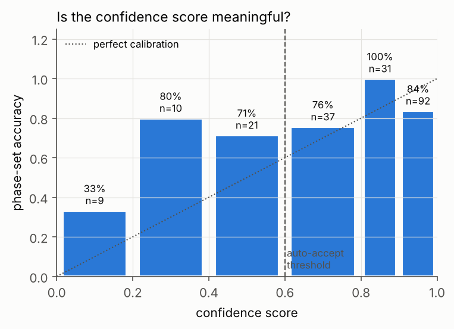
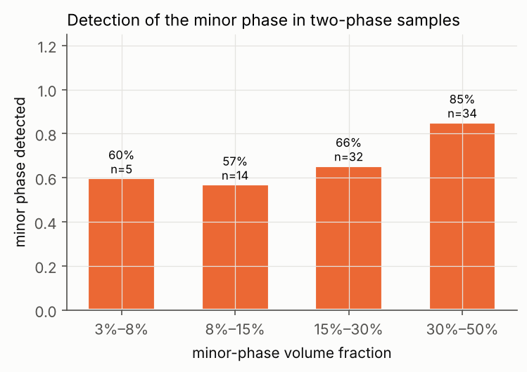
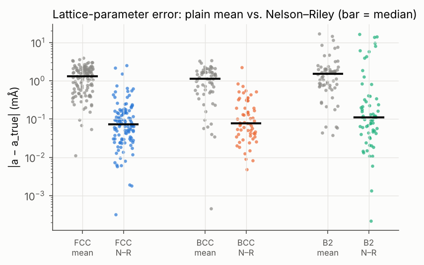
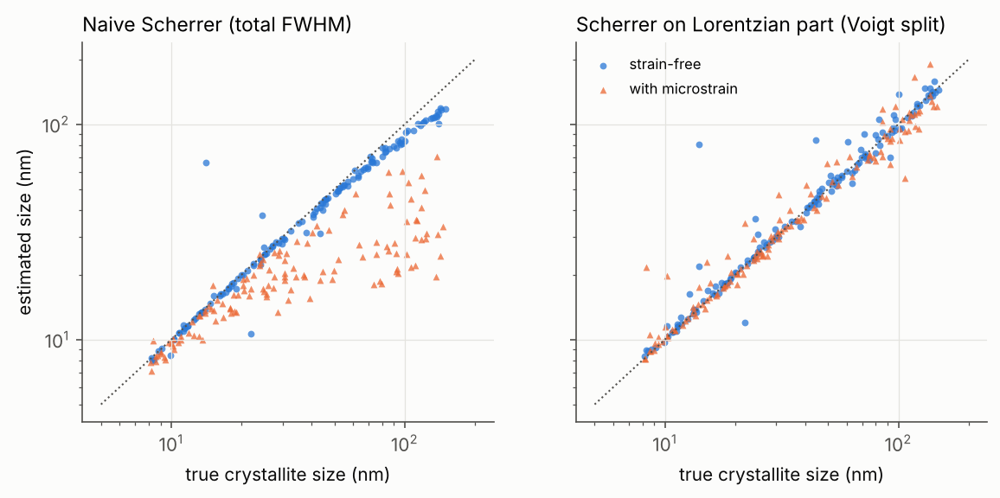

# Benchmark report (auto-generated by `scripts/make_report.py`)

200 synthetic samples, seed 2026. Runtime median 0.6 s/sample.

## Headline numbers

| metric | value |
|---|---|
| phase-set accuracy, all samples (best guess) | 81% (162/200) |
| auto-accepted | 101 (50%) |
| accuracy of auto-accepted results | 96% |
| **silent failures** (auto-accepted but wrong) | **4** (2% of all) |
| sent to review | 99 (50%) |
| …of which the best guess was wrong (review justified) | 34 |
| …of which the best guess was right (cautious) | 65 |
| wrong answers caught by review | 34/38 (89%) |

### Development set vs. held-out set

Thresholds (review rules, confidence weights) were tuned while looking at the development set (seed 2026). The held-out set (seed 7, same sample-type mix, never used for tuning) is the honest estimate.

| | development (seed 2026) | held-out (seed 7) |
|---|---|---|
| best-guess accuracy | 81% | 76% |
| auto-accepted | 50% | 56% |
| accuracy when auto-accepted | 96% | 91% |
| silent failures | 4 | 10 |
| wrong answers caught by review | 89% | 79% |

Held-out silent failures:

| id | truth | predicted | counts |
|---|---|---|---|
| S119 | FCC 97% a=3.574 D=126nm, BCC 3% a=2.873 D=11nm | FCC | 26622 |
| S132 | FCC 77% a=3.636 D=44nm, B2 23% a=2.909 D=10nm S=0.86 | FCC | 2014 |
| S143 | FCC 97% a=3.616 D=122nm, B2 3% a=2.880 D=68nm S=0.59 | FCC | 13422 |
| S155 | FCC 94% a=3.565 D=16nm, sigma 6% a=8.854 D=46nm | FCC | 3219 |
| S160 | FCC 92% a=3.625 D=54nm, sigma 8% a=8.906 D=24nm | FCC | 20461 |
| S166 | FCC 94% a=3.590 D=35nm, sigma 6% a=8.901 D=51nm | FCC | 45848 |
| S170 | FCC 74% a=3.627 D=20nm, sigma 26% a=8.776 D=13nm | FCC | 1618 |
| S175 | BCC 89% a=2.900 D=20nm, B2 11% a=2.914 D=43nm S=0.45 | BCC | 25854 |
| S178 | BCC 87% a=2.856 D=39nm, B2 13% a=2.877 D=9nm S=0.54 | BCC | 41278 |
| S188 | BCC 95% a=2.868 D=10nm, B2 5% a=2.897 D=13nm S=0.62 | BCC | 50926 |

## By sample type (development set)

| type | n | best-guess accuracy | auto-accepted | accuracy when auto | silent failures |
|---|---|---|---|---|---|
| FCC | 30 | 100% | 93% | 100% | 0 |
| BCC | 25 | 100% | 60% | 100% | 0 |
| B2 | 25 | 100% | 68% | 100% | 0 |
| sigma | 10 | 100% | 100% | 100% | 0 |
| FCC+BCC | 30 | 87% | 23% | 100% | 0 |
| FCC+B2 | 25 | 76% | 20% | 80% | 1 |
| FCC+sigma | 30 | 53% | 57% | 82% | 3 |
| BCC+B2 | 25 | 44% | 8% | 100% | 0 |

## Confidence calibration

| confidence | n | accuracy |
|---|---|---|
| 0.0–0.4 | 19 | 58% |
| 0.4–0.6 | 21 | 71% |
| 0.6–0.8 | 37 | 76% |
| 0.8–0.9 | 31 | 100% |
| 0.9–1.0 | 92 | 84% |

## Review flags

How often each review flag fired, and how often the best guess was actually wrong when it did.

| flag | fired | best guess wrong |
|---|---|---|
| `BCC_B2_AMBIGUOUS` | 55 | 15 (27%) |
| `LOW_CONFIDENCE` | 40 | 14 (35%) |
| `LOW_SENSITIVITY` | 24 | 10 (42%) |
| `UNEXPLAINED_PEAKS` | 20 | 20 (100%) |
| `AMBIGUOUS_ALTERNATIVE` | 17 | 5 (29%) |
| `OVERLAPPING_PHASES` | 11 | 3 (27%) |
| `MISSING_REFLECTIONS` | 3 | 0 (0%) |

## Minor-phase detection

| minor fraction | n | detected | missed ones sent to review |
|---|---|---|---|
| 3%–8% | 5 | 60% | 50% |
| 8%–15% | 14 | 57% | 67% |
| 15%–30% | 32 | 66% | 91% |
| 30%–50% | 34 | 85% | 100% |

## Lattice parameters (correctly identified cubic phases, ≥3 peaks)

| phase | n | median abs error, mean of peaks (Å) | median abs error, Nelson–Riley (Å) | NR better in |
|---|---|---|---|---|
| FCC | 115 | 0.00129 | 0.00007 | 94% |
| BCC | 61 | 0.00114 | 0.00008 | 92% |
| B2 | 64 | 0.00151 | 0.00011 | 81% |

Sigma (LSQ a, c + displacement), n = 26: median |Δa| = 0.0031 Å, median |Δc| = 0.0017 Å.

## Crystallite size

Median |log₁₀(D_est / D_true)| for correctly identified phases, D reported (not lower-bound):

| subset | n | naive Scherrer | Lorentzian-part Scherrer |
|---|---|---|---|
| strain-free | 136 | 0.021 (×1.05) | 0.010 (×1.02) |
| with microstrain | 129 | 0.140 (×1.38) | 0.021 (×1.05) |
| D_true < 50 nm | 165 | 0.025 (×1.06) | 0.010 (×1.02) |
| D_true ≥ 50 nm | 100 | 0.085 (×1.22) | 0.026 (×1.06) |

## Every wrong answer

| id | truth | predicted | status | conf | counts | review flags |
|---|---|---|---|---|---|---|
| S133 | FCC 83% a=3.601 D=26nm, B2 17% a=2.880 D=11nm S=0.81 | FCC | **AUTO** | 0.97 | 4446 | — |
| S151 | FCC 89% a=3.601 D=102nm, sigma 11% a=8.790 D=9nm | FCC | **AUTO** | 0.97 | 5467 | — |
| S153 | FCC 95% a=3.610 D=50nm, sigma 5% a=8.842 D=17nm | FCC | **AUTO** | 0.98 | 12986 | — |
| S154 | FCC 86% a=3.602 D=32nm, sigma 14% a=8.779 D=9nm | FCC | **AUTO** | 0.98 | 28448 | — |
| S091 | FCC 81% a=3.633 D=43nm, BCC 19% a=2.888 D=8nm | FCC | review | 0.97 | 2530 | LOW_SENSITIVITY |
| S092 | FCC 82% a=3.621 D=57nm, BCC 18% a=2.887 D=19nm | FCC | review | 0.71 | 12188 | UNEXPLAINED_PEAKS |
| S115 | FCC 91% a=3.597 D=65nm, BCC 9% a=2.894 D=50nm | FCC | review | 0.98 | 12357 | UNEXPLAINED_PEAKS |
| S118 | FCC 88% a=3.614 D=62nm, BCC 12% a=2.878 D=119nm | FCC | review | 0.97 | 3528 | LOW_SENSITIVITY, UNEXPLAINED_PEAKS |
| S123 | FCC 92% a=3.637 D=113nm, B2 8% a=2.914 D=48nm S=0.79 | FCC | review | 0.97 | 2566 | LOW_SENSITIVITY, UNEXPLAINED_PEAKS |
| S124 | FCC 56% a=3.629 D=53nm, B2 44% a=2.912 D=11nm S=0.66 | BCC + FCC | review | 0.63 | 5729 | BCC_B2_AMBIGUOUS |
| S134 | FCC 71% a=3.614 D=52nm, B2 29% a=2.869 D=22nm S=0.83 | FCC | review | 0.66 | 3118 | LOW_SENSITIVITY, UNEXPLAINED_PEAKS |
| S135 | FCC 52% a=3.633 D=41nm, B2 48% a=2.902 D=13nm S=0.49 | BCC + FCC | review | 0.68 | 3980 | BCC_B2_AMBIGUOUS |
| S138 | FCC 81% a=3.637 D=92nm, B2 19% a=2.894 D=78nm S=0.54 | BCC + FCC | review | 0.54 | 2693 | BCC_B2_AMBIGUOUS, LOW_CONFIDENCE, OVERLAPPING_PHASES |
| S146 | FCC 78% a=3.620 D=30nm, sigma 22% a=8.827 D=18nm | FCC | review | 0.97 | 1691 | LOW_SENSITIVITY |
| S149 | FCC 82% a=3.593 D=73nm, sigma 18% a=8.903 D=48nm | FCC | review | 0.65 | 18358 | UNEXPLAINED_PEAKS |
| S150 | FCC 77% a=3.598 D=85nm, sigma 23% a=8.895 D=12nm | BCC + FCC | review | 0.33 | 37176 | LOW_CONFIDENCE, OVERLAPPING_PHASES, UNEXPLAINED_PEAKS |
| S155 | FCC 79% a=3.588 D=87nm, sigma 21% a=8.791 D=14nm | FCC | review | 0.98 | 15231 | UNEXPLAINED_PEAKS |
| S157 | FCC 90% a=3.591 D=40nm, sigma 10% a=8.889 D=123nm | FCC | review | 0.93 | 4251 | UNEXPLAINED_PEAKS |
| S158 | FCC 81% a=3.590 D=121nm, sigma 19% a=8.819 D=24nm | FCC | review | 0.97 | 3334 | LOW_SENSITIVITY |
| S159 | FCC 60% a=3.617 D=9nm, sigma 40% a=8.911 D=14nm | BCC + FCC | review | 0.03 | 41209 | BCC_B2_AMBIGUOUS, LOW_CONFIDENCE, OVERLAPPING_PHASES, UNEXPLAINED_PEAKS |
| S162 | FCC 91% a=3.602 D=25nm, sigma 9% a=8.874 D=68nm | FCC | review | 0.97 | 1765 | UNEXPLAINED_PEAKS |
| S167 | FCC 67% a=3.597 D=146nm, sigma 33% a=8.914 D=29nm | FCC | review | 0.59 | 1693 | LOW_CONFIDENCE, LOW_SENSITIVITY, UNEXPLAINED_PEAKS |
| S168 | FCC 75% a=3.584 D=103nm, sigma 25% a=8.836 D=38nm | FCC | review | 0.77 | 1732 | LOW_SENSITIVITY, UNEXPLAINED_PEAKS |
| S169 | FCC 68% a=3.595 D=109nm, sigma 32% a=8.832 D=22nm | FCC | review | 0.78 | 3703 | UNEXPLAINED_PEAKS |
| S175 | BCC 62% a=2.907 D=12nm, B2 38% a=2.889 D=10nm S=0.60 | B2 | review | 0.44 | 4984 | AMBIGUOUS_ALTERNATIVE, BCC_B2_AMBIGUOUS, LOW_CONFIDENCE |
| S176 | BCC 64% a=2.882 D=70nm, B2 36% a=2.898 D=14nm S=0.71 | B2 | review | 0.14 | 47322 | BCC_B2_AMBIGUOUS, LOW_CONFIDENCE, UNEXPLAINED_PEAKS |
| S177 | BCC 83% a=2.876 D=33nm, B2 17% a=2.878 D=38nm S=0.92 | B2 | review | 0.47 | 56388 | AMBIGUOUS_ALTERNATIVE, BCC_B2_AMBIGUOUS, LOW_CONFIDENCE |
| S181 | BCC 66% a=2.871 D=53nm, B2 34% a=2.894 D=11nm S=0.53 | BCC | review | 0.60 | 53291 | LOW_CONFIDENCE, UNEXPLAINED_PEAKS |
| S185 | BCC 61% a=2.878 D=10nm, B2 39% a=2.886 D=8nm S=0.95 | B2 | review | 0.66 | 24158 | BCC_B2_AMBIGUOUS |
| S187 | BCC 57% a=2.879 D=8nm, B2 43% a=2.888 D=92nm S=0.86 | B2 | review | 0.08 | 4803 | LOW_CONFIDENCE, LOW_SENSITIVITY, UNEXPLAINED_PEAKS |
| S188 | BCC 83% a=2.893 D=11nm, B2 17% a=2.900 D=22nm S=0.70 | B2 | review | 0.15 | 3431 | AMBIGUOUS_ALTERNATIVE, BCC_B2_AMBIGUOUS, LOW_CONFIDENCE |
| S191 | BCC 76% a=2.912 D=44nm, B2 24% a=2.903 D=53nm S=0.66 | BCC | review | 0.94 | 1928 | BCC_B2_AMBIGUOUS, UNEXPLAINED_PEAKS |
| S193 | BCC 64% a=2.888 D=34nm, B2 36% a=2.901 D=24nm S=0.94 | B2 | review | 0.19 | 20149 | AMBIGUOUS_ALTERNATIVE, BCC_B2_AMBIGUOUS, LOW_CONFIDENCE, UNEXPLAINED_PEAKS |
| S194 | BCC 59% a=2.887 D=10nm, B2 41% a=2.897 D=10nm S=0.98 | B2 | review | 0.73 | 17102 | BCC_B2_AMBIGUOUS |
| S195 | BCC 70% a=2.894 D=8nm, B2 30% a=2.900 D=8nm S=0.94 | B2 | review | 0.55 | 33331 | BCC_B2_AMBIGUOUS, LOW_CONFIDENCE |
| S196 | BCC 82% a=2.893 D=18nm, B2 18% a=2.897 D=20nm S=0.81 | B2 | review | 0.10 | 55496 | AMBIGUOUS_ALTERNATIVE, BCC_B2_AMBIGUOUS, LOW_CONFIDENCE |
| S197 | BCC 87% a=2.893 D=106nm, B2 13% a=2.880 D=23nm S=0.98 | BCC | review | 0.90 | 3557 | BCC_B2_AMBIGUOUS, LOW_SENSITIVITY |
| S198 | BCC 64% a=2.918 D=86nm, B2 36% a=2.895 D=12nm S=0.53 | BCC | review | 0.37 | 42419 | LOW_CONFIDENCE, UNEXPLAINED_PEAKS |
